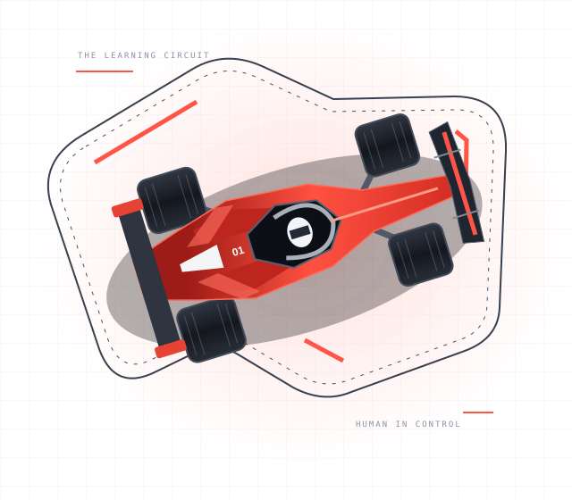

GITHUB COPILOT / HANDS-ON WORKSHOP

# Build fast. Think for yourself.

AI is your co-driver. You're the engineer. Go from local setup to AI-assisted
coding and agent-led development on a real Formula 1 project. Compare the
workflows, challenge the output, and keep judgement in the driver's seat.

[Start the workshop &rarr;](./setup.md) [Explore the workflows](#two-paths-one-finish-line)

MODE: HANDS-ONDRIVER: YOU

  
<strong>02</strong>WORKFLOWS TO COMPARE

  
<strong>02</strong>REAL-WORLD LABS

  
<strong>~5 hrs</strong>LABS + COMPARISON

  
<strong>01</strong>ENGINEER IN CONTROL

THE BRIEF / A NEW WAY TO BUILD

## Learn the tools. Own the decisions.

New to the environment? Choose [native Windows or macOS](./native-setup.md),
or [Windows with WSL](./wsl-setup.md). WSL is optional, not a workshop requirement.
Then explore [AI-assisted versus AI-native development](./ai-development.md):
when to ask for a focused suggestion, when to delegate a bounded task, and what
you still need to understand, test, and review.

Working style and workflow structure are different choices. You can use
developer-led assistance or agent-led execution with **either** path below.
Allow extra time for onboarding and the AI orientation.

01 / PICK YOUR RACING LINE

## Two paths. One finish line.

The same F1 application. The same requirements. Two ways
to work with Copilot. Find out how much process your task actually needs,
instead of assuming that faster or more structured is always better.

PATH A / THE QUICK LINE

### Copilot-native

Go from a clear brief to a reviewed plan, scoped changes, and working tests.
Keep the process lightweight, with human approval at the important moments.

Explore &rarr; Plan &rarr; Approve Implement &rarr; Verify

Best question to ask: **How much structure is enough?**

[Take the Copilot-native path &rarr;](./copilot-native.md)

PATH B / THE STRATEGY LINE

### Copilot + Spec Kit

Make the requirements explicit. Work through specifications, contracts,
and tasks before implementation, then check whether the extra structure paid off.

Specify &rarr; Clarify &rarr; Plan Tasks &rarr; Implement &rarr; Verify

Best question to ask: **When does structure earn its keep?**

[Take the Spec Kit path &rarr;](./copilot-spec-kit.md)

02 / FROM THE PIT LANE TO THE FINISH

## Your weekend on the grid.

Get the project running, test both approaches on the same
challenges, then make a decision backed by evidence. No blind acceptance.
No points for generating more code.

01 / THE PIT LANE

### Get race-ready.

Start with [native Windows or macOS](./native-setup.md),
[Windows + WSL](./wsl-setup.md), or shared project setup. Run the app,
connect Copilot, and record a passing baseline before edits.

[Set up your environment &rarr;](./setup.md)

02 / THE SPRINT

### Find the wrong turn.

A request succeeds but returns the wrong data. Repair the query parser,
challenge an AI suggestion, and prove the fix with a regression test.

[Enter the repair lab &rarr;](./repair-lab.md)

03 / THE GRAND PRIX

### Build. Test. Defend.

Add a data-coverage feature across the API and UI. Compare review effort,
rework, and correctness across both paths.

[Enter the feature lab &rarr;](./feature-lab.md)

Repeat the labs on the other path from an independent baseline, then
[compare your evidence and reflect](./assessment.md). The paths are alternatives
to evaluate, not sequential implementation steps. Short on time? Start with
setup and the paired repair lab.

i

### The workshop is online. Your F1 app runs locally.

GitHub Pages serves this tutorial; run FastAPI locally using the setup guide.
You'll need basic Python, Git, Python 3.12+, VS Code, and suitable Copilot access.
No runtime LLM, API keys, database, or frontend bundler is required for the labs.
The checked-in season files are samples, not verified complete seasons.

## In the instructor's garage.

Use the [assessment rubric and pilot checklist](./assessment.md) to teach the
workshop. Timing is an estimate, so complete an instructor pilot before class.
The [publishing walkthrough](./publishing.md) explains how to deploy your own copy.
The [source repository](https://github.com/cknzraposo/f1-app) retains the original
Spec Kit showcase and standalone debugging lessons.
